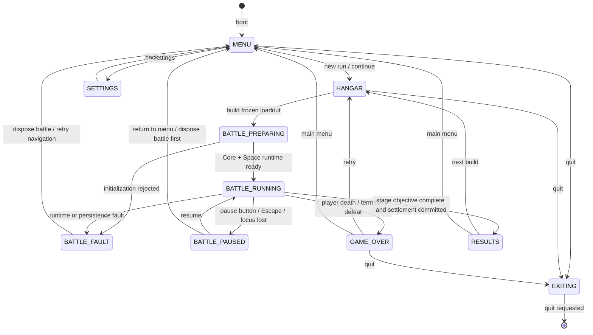

# Application Flow and UI State Machine

Status: architecture contract for the full application lifecycle. This document describes the current flow and the target rules for extending it. It does not introduce a third-party scene manager or alter gameplay rules.

## 1. Director model

Treat the application as a theatre production:
- **Application Director**: `GameFlow` autoload. The only authority allowed to change the root scene and application screen state.
- **Scenes**: Menu, Hangar, Battle, GameOver and future Settings/Results/Loading scenes. They are presentation/interaction stages, not lifecycle owners.
- **Battle owner**: `Game.gd`, which owns one battle instance and its World V2 host lifetime.
- **Overlay actors**: pause, confirmation, fault and other modal layers. They may request transitions but cannot replace the root scene or mutate Jar state.
- **Domain/runtime**: Jar Core, Space production/parser, order effects, objectives and settlement. The director must not implement their rules.

## 2. Two orthogonal state dimensions

Do not collapse all UI visibility into a single boolean.

### Application screen

Current implementation:
- `MENU`
- `HANGAR`
- `BATTLE`
- `GAME_OVER`

Target extension points (only add when the scene exists):
- `SETTINGS`
- `STAGE_CLEAR` / `RESULTS`
- `LOADING`
- `EXITING`

### Battle lifecycle

Current implementation in `GameFlow.BattlePhase`:
- `INACTIVE`
- `PREPARING`
- `RUNNING`
- `PAUSED`
- `RESUMING`
- `RESUME_READY`
- `ENDED`
- `FAULTED`

### Overlay state

Overlay visibility is local to the owning scene and never substitutes for application screen or battle lifecycle:
- `NONE`
- `PAUSE`
- `FAULT`
- `CONFIRM_EXIT`
- `SETTINGS_MODAL`

A pause overlay is legal only while screen is BATTLE and phase is PAUSED. A fault overlay is legal only after GameFlow has entered FAULTED. GAME_OVER is a separate root scene after the battle is ENDED; it is not a pause overlay.

## 3. Directed application flow

The diagram includes future extension points. Do not add enum values or placeholder scenes until the corresponding route is implemented and tested.

## 4. Transition contract

Every transition is a command with:
1. source screen and source battle phase;
2. requested intent;
3. guard/precondition;
4. lifecycle action (dispose, pause, persist, or none);
5. destination scene;
6. rollback behavior if scene loading fails.

Only `GameFlow` calls `SceneTree.change_scene_to_file`. Scene scripts call named intent methods; they do not call `change_scene_to_file` directly.

### Required route behavior

| Intent | Guard | Required action | Destination |
|---|---|---|---|
| Start run | MENU | Reset run, open Hangar | HANGAR |
| Build battle | HANGAR, valid frozen loadout | Freeze identity, create battle | BATTLE |
| Pause | BATTLE/RUNNING | Pause Host, then SceneTree | BATTLE + PAUSE |
| Resume | BATTLE/PAUSED | Validate phase, resume Host and SceneTree | BATTLE |
| Return to menu | BATTLE/PAUSED or terminal | End/dispose Host before scene switch | MENU |
| Player died | BATTLE/RUNNING | Stop simulation, close Host, record result | GAME_OVER |
| Retry | GAME_OVER | Reset run, preserve Hangar selection policy | HANGAR |
| Fault recovery | BATTLE/FAULTED | Host already disposed; retry scene navigation | MENU |
| Quit | Any non-transitioning state | End battle if active, persist required profile, quit tree | EXITING |

Transitions must be idempotent or reject duplicate commands. A scene must not be able to start a second battle while another is preparing, running, paused, or resuming.

## 5. Input and focus contract

Godot UI input is delivered through Viewports and Control hit-testing. The visible rectangle is not enough: a child button drawn outside its parent Control's rectangle may not receive the expected pointer event. Background decoration must use `MOUSE_FILTER_IGNORE`; interactive controls must remain in the hit-test path and have explicit focus behavior.

For each screen:
- every visible button must be inside the interactive parent Control's global rectangle;
- decorative full-screen ColorRects must ignore mouse input;
- primary actions must be keyboard/gamepad focusable;
- after a modal opens, focus moves to its primary action;
- after a modal closes, focus returns to the control that opened it where practical;
- pause UI uses `PROCESS_MODE_ALWAYS` or `WHEN_PAUSED` intentionally; gameplay stays pausable;
- focus loss pauses gameplay but focus regain never silently resumes it.

The MainMenu and GameOver scenes both had centered VBoxContainers only 40 px wide while their buttons rendered outside those parent hit areas. Both containers now have explicit 420+ px interactive bounds and their full-screen background ColorRects ignore mouse input. Hangar's decorative background also ignores pointer input. These are interaction geometry defects, not visual-theme defects.

## 6. Battle terminal states and checkpoints

Death and battle fault are distinct:
- **Death** is a normal terminal gameplay result. Stop simulation, close the Host, record score, then show GAME_OVER. Do not require a resumable mid-stage checkpoint after the player has died.
- **Fault** is an infrastructure/contract failure. Stop simulation, close the Host, preserve diagnostic context, show a terminal fault action.
- **Pause** is non-terminal. Preserve the live Host and resume only through the owning controller.
- **Stage clear** is terminal only after objective completion and durable settlement.

Finite-stage resumable checkpoints are currently safe only in an enemy-free inter-beat boundary because active enemy actors and spawn scheduling are not serialized. Therefore a checkpoint provider returning an empty Dictionary during an active beat is an expected deferral, not an error. Order effects may be applied in memory once; the Jar outbox event must remain pending until the full coherent checkpoint can be saved. Do not acknowledge the event or overwrite a newer full checkpoint with a partial snapshot.

A death terminal path must not call the resumable checkpoint provider. Pending outbox events are abandoned only as part of disposing that terminal World instance; they must never leak into a newly created World instance.

## 7. Godot implementation rules

- Use one root-scene director; do not scatter scene-change calls across buttons and gameplay nodes.
- Use `process_mode` deliberately. A paused UI that inherits PAUSABLE will appear but stop receiving input.
- Use `mouse_filter = IGNORE` for decorative Controls (ColorRect, icons, labels that should not block buttons).
- Set a real minimum size on containers. Do not let children visually overflow a tiny parent hit rectangle.
- Use `focus_mode = ALL`, explicit initial focus, and test keyboard/gamepad navigation.
- Do not use `ui_accept/ui_up/ui_down/ui_focus_next` as gameplay actions; they are reserved for UI navigation.
- Avoid a third-party scene manager unless it demonstrably solves a missing requirement. The project already has a lifecycle owner; replacing native scene transitions would enlarge the migration surface.

## 8. Verification matrix

| Route | Automated verification | Desktop acceptance |
|---|---|---|
| Boot → Menu | main scene import + menu ready probe | menu visible and actionable |
| Menu → Hangar | transition guard probe | click start |
| Hangar → Battle | frozen loadout + cross-repo probes | build default loadout |
| Battle → Pause → Resume | pause controller probe | click button and press Escape |
| Battle → Menu | terminal disposal probe | click Main Menu while paused |
| Battle → Death → GameOver | death lifecycle probe | die and inspect GameOver |
| GameOver → Hangar | UI geometry + transition probe | click retry |
| GameOver → Menu | UI geometry + transition probe | click Main Menu |
| Any scene → Quit | exit intent probe | window closes without orphan Host |
| Runtime fault → Menu | fault overlay + Host disposal probe | fault screen remains actionable |

Headless tests prove state transitions and input geometry. They do not prove mouse usability or visual hierarchy; each root screen still requires desktop acceptance.

## 9. Open-source options reviewed

- **Godot built-in SceneTree + a project-owned director**: preferred. It preserves the existing `GameFlow` owner and keeps transitions explicit.
- **GState**: a hierarchical, event-driven Godot 4 state-machine addon with nested/compound states and graph editing. It may be useful if the number of orthogonal state machines becomes hard to maintain, but adopting it now would duplicate an existing state authority and add plugin lifecycle risk. Keep it as a reference, not a dependency.
- **Scene Manager addons**: useful for transition animations/loading wrappers, but not a replacement for battle ownership, terminal disposal, pause semantics, or transaction contracts.
- **Scenic**: its published description says it circumvents the regular Godot scene system. That is a poor fit for a project whose correctness depends on explicit scene ownership and teardown.
- **GodotSceneManager (esdg)**: its installation guide targets Godot 4.5 Mono/.NET and introduces a graph schema and an AutoLoad controller. It is a possible future editor workflow, but the current project uses Godot 4.7.1 Mono; compatibility and maintenance must be verified before adoption.

No external plugin is added in this phase. Keep `GameFlow` as the director, make the state graph and transition contracts testable, and adopt a plugin only when it replaces rather than duplicates authority.

## 10. External references

- Godot Engine, *Control*: Control bounding rectangles, Viewport input propagation, focus, and `mouse_filter`: https://docs.godotengine.org/en/stable/classes/class_control.html
- Godot Engine, *Pausing games and process mode*: SceneTree pause and Inherit/Pausable/WhenPaused/Always/Disabled semantics: https://docs.godotengine.org/en/stable/tutorials/scripting/pausing_games.html
- GState (MIT): hierarchical/event-driven Godot 4 state machine with nested/compound states and graph editor: https://github.com/fufuShih/GState
- GodotSceneManager (MIT): schema-driven scene flow editor; published installation guide currently states Godot 4.5 Mono/.NET and adds an AutoLoad controller: https://github.com/esdg/GodotSceneManager/blob/main/addons/ScenesManager/Docs/installation.md
- Scenic: scene manager that owns a persistent main scene and routes scene loading/switching, rather than using the regular scene system directly: https://store.godotengine.org/asset/flown/scenic/
